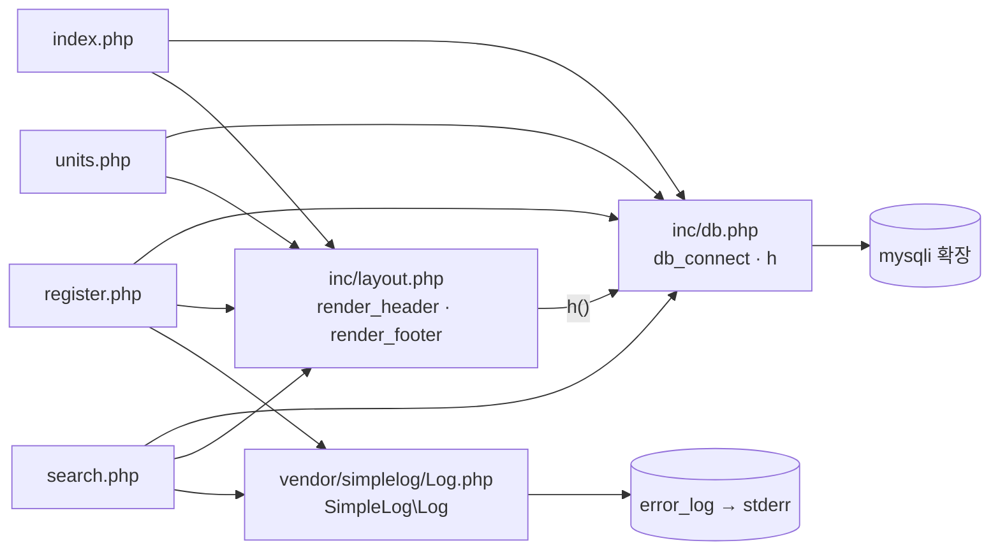

# item-bank-php 아키텍처 (진입점 · 의존 관계)

대상: `legacy/item-bank-php/`. 분석 범위는 진입점과 의존 관계까지이고, 데이터 흐름과 비즈니스 규칙은 아직 분석하지 않았다.
`search.php` 를 뺀 파일은 모두 읽었다. `search.php` 는 1–60줄 · 520–731줄을 읽었고, 61–519줄은 grep 으로 걸린 줄만 확인했다.

## 1. 모듈 개요

- 문항 검색 · 문항 등록 · 단원 목록 화면을 제공하는 PHP 7.4 + Apache 앱이다(`Dockerfile:1`).
- 라우터 없이 문서 루트 `/var/www/html` 의 `.php` 파일이 URL 로 바로 실행된다(`Dockerfile:14`).
- DB 는 `mysqli` 확장으로 접속하고(`Dockerfile:3`, `inc/db.php:21`), 화면 파일 안에 SQL 과 HTML 출력이 함께 있다.
- 공통 코드는 `inc/db.php`(DB 연결 · 이스케이프)와 `inc/layout.php`(머리말 · 꼬리말) 두 파일이다.
- 로그는 `vendor/simplelog/Log.php` 가 `error_log()` 로 남기며(`Log.php:52`), 출력 대상은 stderr 다(`Dockerfile:10`).

## 2. 폴더 구조

```
legacy/item-bank-php/
├── Dockerfile                 16줄   php:7.4-apache, mysqli 설치, php.ini 설정
├── index.php                  14줄   홈(메뉴)
├── units.php                  48줄   단원 목록
├── register.php              177줄   문항 등록
├── search.php                731줄   문항 검색 (모듈 코드의 약 2/3)
├── inc/
│   ├── db.php                 37줄   db_connect(), h()
│   └── layout.php             43줄   render_header(), render_footer()
└── vendor/
    └── simplelog/
        └── Log.php            54줄   SimpleLog\Log (debug/info/warn/error)
```

- `composer.json` · autoload · 빌드 산출물 · 캐시 폴더는 없다.
- `vendor/simplelog/` 는 Composer 패키지가 아닌 파일 1개짜리 코드다(`Log.php:3` 주석: "외부 라이브러리(더미). 수정하지 말 것.").

## 3. 진입점 표

`inc/*.php` 와 `vendor/simplelog/Log.php` 에는 함수 · 클래스 정의만 있고 최상위 실행 코드가 없으므로 진입점이 아니다(`inc/db.php:7-37`, `inc/layout.php:7-43`, `Log.php:9-54`).

| URL / 화면 | 처음 실행되는 파일 | 부르는 주요 함수 (순서대로) |
|---|---|---|
| `/index.php` 홈(메뉴) | `index.php` | `render_header('홈')` `index.php:5` → `render_footer()` `index.php:14`. DB 는 include 만 하고 호출하지 않는다(`index.php:2`). |
| `/units.php` 단원 목록 | `units.php` | `render_header` `units.php:5` → `db_connect` `units.php:8` → `$conn->query` `units.php:20` → `h` `units.php:40-43` → `render_footer` `units.php:48` |
| `/register.php` 문항 등록 (GET: 폼, POST: 등록) | `register.php` | `db_connect` `register.php:17` → `$conn->query`(단원 · 태그 목록) `register.php:27`, `register.php:34` → POST 일 때 `begin_transaction` `register.php:85` · `prepare`/`execute` `register.php:92-108` · `commit` `register.php:114` · `Log::info` `register.php:115` / 실패 시 `rollback` · `Log::error` `register.php:120-121` → `render_header` `register.php:127` → `render_footer` `register.php:177` |
| `/search.php` 문항 검색 (GET 파라미터: `search.php:5-12`) | `search.php` | `Log::setThreshold` `search.php:27` → `render_header` `search.php:709` → `db_connect` `search.php:713` → `buildSearchQuery($_GET, …)` `search.php:722` → `renderSearchForm` `search.php:723` → `runSearchQuery` `search.php:724` → `renderResultTable` `search.php:725` → `render_footer` `search.php:731` |

## 4. 의존 관계

화살표 방향: A → B 는 "A 가 B 를 포함하거나 호출한다".



### 4.1 파일 포함 (require_once)

| A | → B | 근거 |
|---|---|---|
| `index.php` | `inc/db.php`, `inc/layout.php` | `index.php:2`, `index.php:3` |
| `units.php` | `inc/db.php`, `inc/layout.php` | `units.php:2`, `units.php:3` |
| `register.php` | `inc/db.php`, `inc/layout.php`, `vendor/simplelog/Log.php` | `register.php:2`, `register.php:3`, `register.php:4` |
| `search.php` | `inc/db.php`, `inc/layout.php`, `vendor/simplelog/Log.php` | `search.php:20`, `search.php:21`, `search.php:22` |

### 4.2 함수 호출

| A | → B | 근거 |
|---|---|---|
| 화면 파일 4개 | `render_header` / `render_footer` | 3절 진입점 표 |
| `units.php` · `register.php` · `search.php` | `db_connect` | `units.php:8`, `register.php:17`, `search.php:713` |
| `inc/layout.php` | `inc/db.php` 의 `h()` | `inc/layout.php:17`, `inc/layout.php:33` |
| `inc/db.php` | PHP `mysqli` 확장 | `inc/db.php:21` (설치: `Dockerfile:3`) |
| `register.php` | `SimpleLog\Log::info` / `::error` | `register.php:115`, `register.php:121` |
| `search.php` | `SimpleLog\Log::setThreshold` / `::debug` / `::error` | `search.php:27`, `:103`, `:528`, `:537`, `:727` |
| `vendor/simplelog/Log.php` | PHP `error_log()` (stderr) | `Log.php:52`, `Dockerfile:10` |

`inc/layout.php` 에는 require 가 없다. 화면 파일이 `inc/db.php` 를 먼저 include 해야 `h()` 가 정의된다.

### 4.3 search.php 내부 호출

| A | → B | 근거 |
|---|---|---|
| 최상위 | `buildSearchQuery` → `renderSearchForm` → `runSearchQuery` → `renderResultTable` | `search.php:722-725` |
| `buildSearchQuery` | `h` (16곳) | `search.php:360` 외 |
| `buildSearchQuery` | `$conn->prepare` / `$conn->query` | `search.php:125`, `:156`, `:178` |
| `buildSearchQuery` | `Log::debug` / `Log::error` | `search.php:103`, `:528`, `:537` |
| `runSearchQuery` | `$conn->prepare` ×2 (건수 · 페이지) | `search.php:577`, `:600` |
| `renderSearchForm` | `buildSearchQuery` 가 만든 `form_html` 을 그대로 출력 | `search.php:631-637` |
| `renderResultTable` | `h` | `search.php:674-678`, `:690`, `:696` |

### 4.4 DB 객체

| 파일 | 테이블 · 뷰 | 근거 |
|---|---|---|
| `units.php` | `unit`, `item` | `units.php:16-18` |
| `register.php` | `unit`, `tag`, `item`, `item_tag` | `register.php:27`, `:34`, `:87`, `:93`, `:105` |
| `search.php` | `unit`, `tag`, 뷰 `v_item_public` | `search.php:125`, `:156`, `:178`, `:522` |

## 5. 가장 긴 함수 3개

모든 함수의 시작 · 끝 줄을 확인해서 비교했다. 4위부터는 `render_header` 30줄(`inc/layout.php:7-36`), `db_connect` 23줄(`inc/db.php:7-29`)이다.

| 순위 | 파일 | 함수 | 시작–끝 (줄 수) | 하는 일 |
|---|---|---|---|---|
| 1 | `search.php` | `buildSearchQuery` | `42`–`564` (523줄) | GET 파라미터로 검색 SQL · 건수 SQL · 바인딩 값 · 폼/요약/정렬 링크 HTML 을 한꺼번에 조립한다(`search.php:29-41`, 반환 `:541-563`). |
| 2 | `search.php` | `renderResultTable` | `647`–`704` (58줄) | 경고 · 요약 · 건수 · 결과 표 · 페이지 링크를 출력한다. 0건이면 안내 문구만 낸다(`search.php:657-659`). |
| 3 | `search.php` | `runSearchQuery` | `571`–`624` (54줄) | 건수 쿼리와 현재 페이지 쿼리를 prepared statement 로 각각 실행하고 `{total, rows}` 를 돌려준다(`search.php:623`). |

`buildSearchQuery` 하나가 `search.php` 의 약 72%(523/731줄)를 차지한다.

## 6. 미확인 목록

| 항목 | 이유 · 확인할 곳 |
|---|---|
| `buildSearchQuery` 61–519줄의 조립 과정 (WHERE · 정렬 · 페이징) | grep 으로 걸린 줄(103 · 125 · 156 · 178 · 360 등)만 봤다. `search.php:61-519` |
| `form_html` 조각을 만들 때 이스케이프했는지 | `renderSearchForm` 이 그대로 출력한다(`search.php:631-637`). 만드는 곳은 `search.php:61-519` |
| 뷰 `v_item_public` 의 정의 | `db/mariadb/init/` 을 열지 않았다. |
| 호스트 포트 8081 매핑 | CLAUDE.md 기준이다. 루트 `docker-compose.yml` 을 열지 않았다. |
| `inc/` · `vendor/` 에 URL 로 직접 접근하는 것을 막는 설정 | `.htaccess` 는 없다. Apache 설정은 확인하지 않았다. |
