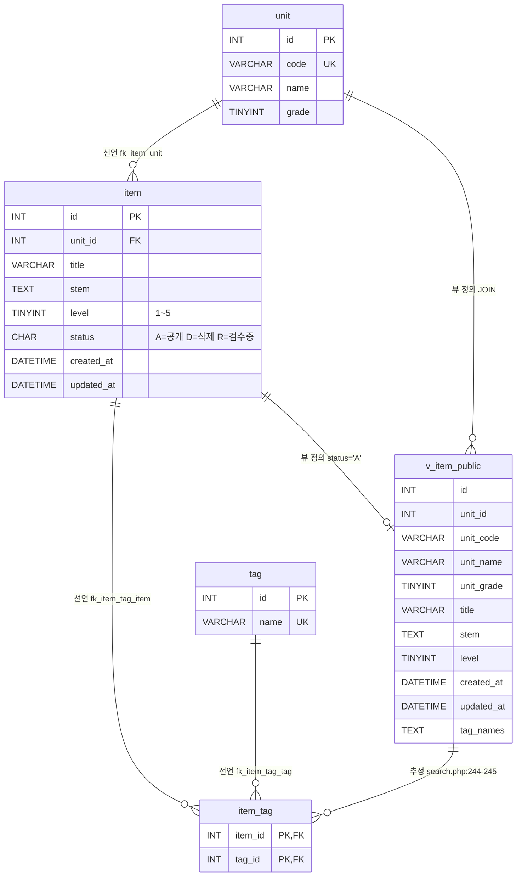

# item-bank-php 데이터 흐름 (테이블 · 관계 · 읽기/쓰기 위치)

대상: `legacy/item-bank-php/`. 진입점 · 의존 관계는 [ARCHITECTURE.md](ARCHITECTURE.md) 를 따른다.

읽은 범위
- 스키마: `db/mariadb/init/01-schema.sql` 전체, `03-users.sql` 전체. `02-seed.sql` 은 `INSERT` 문의 첫 줄만 확인했다.
- 코드: `units.php` · `register.php` · `inc/db.php` 전체. `search.php` 는 40–232줄 · 515–625줄을 읽었고, 233–514줄은 SQL 키워드(`SELECT` · `FROM` · `JOIN` · `WHERE` · `ORDER BY` 등) grep 결과만 확인했다.
- `index.php` · `inc/layout.php` · `vendor/simplelog/Log.php` 에는 SQL 이 없다(grep 결과 0건).

DB 접속: `inc/db.php:7-29` 의 `db_connect()` 가 `mysqli` 로 `itembank` DB 에 접속한다. 기본 계정은 `app`(`inc/db.php:17-18`)이고, 이 계정은 `itembank.*` 전체 권한을 가진다(`03-users.sql:9-10`). 환경 변수 `DB_USER` 등으로 덮어쓸 수 있으며, 실제 실행 시 값은 미확인이다.

## 1. 테이블 목록

item-bank-php 가 접근하는 객체는 테이블 4개와 뷰 1개다.

| 테이블 | 주요 컬럼 | 키 · 제약 | 근거 |
|---|---|---|---|
| `unit` (단원) | `id` INT, `code` VARCHAR(16), `name` VARCHAR(100), `grade` TINYINT | PK `id`, UK `code` | `01-schema.sql:11-18` |
| `item` (문항) | `id` INT, `unit_id` INT, `title` VARCHAR(200), `stem` TEXT, `level` TINYINT(1~5), `status` CHAR(1) 기본 `'A'`(A=공개 D=삭제 R=검수중), `created_at` · `updated_at` DATETIME | PK `id`, FK `unit_id`→`unit.id`, 인덱스 `unit_id` · `level` | `01-schema.sql:20-33` |
| `tag` (태그) | `id` INT, `name` VARCHAR(50) | PK `id`, UK `name` | `01-schema.sql:35-40` |
| `item_tag` (문항–태그) | `item_id` INT, `tag_id` INT | PK (`item_id`, `tag_id`), FK 2개 | `01-schema.sql:42-48` |
| 뷰 `v_item_public` (공개 문항) | `id`, `unit_id`, `unit_code` · `unit_name` · `unit_grade`(← `unit`), `title`, `stem`, `level`, `created_at`, `updated_at`, `tag_names`(태그 이름을 `tag.id` 순으로 쉼표 연결) | `item JOIN unit`, 조건 `i.status = 'A'` | `01-schema.sql:52-70` |

- `item.id` 는 `AUTO_INCREMENT` 가 아니다(`01-schema.sql:21`). 등록 시 `MAX(id)+1` 로 채번한다(`register.php:87`).
- 같은 스키마 파일의 `class` · `assignment` · `distribution` · `submission`(`01-schema.sql:75-115`)은 item-bank-php 코드에서 참조하지 않는다(grep 0건). 이 문서의 범위 밖이다. 단, `assignment.unit_id` 가 `unit.id` 를 참조한다(`01-schema.sql:89`).

## 2. 테이블 관계

표시 규칙
- **선언**: 스키마에 `FOREIGN KEY` 로 선언된 관계.
- **추정**: FK 선언 없이 코드의 JOIN · 상관 서브쿼리 조건에서 추정한 관계.
- **뷰 정의**: `v_item_public` 이 어느 테이블에서 만들어지는지(FK 도 JOIN 추정도 아닌, 뷰 DDL 자체).



| 관계 | 구분 | 근거 |
|---|---|---|
| `item.unit_id` → `unit.id` (N:1) | 선언 | `01-schema.sql:32`. 코드 JOIN 도 같은 조건: `01-schema.sql:69`, `units.php:17` |
| `item_tag.item_id` → `item.id` (N:1) | 선언 | `01-schema.sql:46`. 코드: `01-schema.sql:67` |
| `item_tag.tag_id` → `tag.id` (N:1) | 선언 | `01-schema.sql:47`. 코드: `01-schema.sql:66`, `search.php:244` |
| `item_tag.item_id` → `v_item_public.id` | 추정 | 태그 필터의 `EXISTS` 서브쿼리 `it.item_id = v_item_public.id` (`search.php:244-245`). 뷰에는 FK 를 걸 수 없으므로 코드에서만 드러난다. 실제로는 위 `item_tag.item_id → item.id` 선언 관계를 뷰를 거쳐 쓰는 것이다. |
| `v_item_public` ← `item` (공개 문항만, 1:0..1) | 뷰 정의 | `01-schema.sql:68`, `:70` |
| `v_item_public` ← `unit` (`unit_code` · `unit_name` · `unit_grade`) | 뷰 정의 | `01-schema.sql:56-58`, `:69` |

- item-bank-php 코드의 JOIN 중 FK 선언이 없는 테이블 간 관계는 찾지 못했다. 코드의 JOIN 조건은 모두 선언된 FK 와 같다.
- `search.php` 의 단원 필터는 `v_item_public.unit_code = ?`(`search.php:118`)로 비교하고, 요약 표시용으로 `unit` 을 `code` 로 따로 조회한다(`search.php:125`). 두 쿼리는 JOIN 이 아니라 같은 입력값으로 각각 실행된다.

## 3. 읽기 · 쓰기 위치

`units.php` · `register.php` 는 함수 없이 최상위 코드에서 SQL 을 실행한다. 표에서는 "(최상위)" 로 적는다.
`search.php` 는 `buildSearchQuery` 가 SQL 문자열을 조립하고 `runSearchQuery` 가 실행한다(`search.php:521-526` → `:577`, `:600`).

### 3.1 테이블별 요약

| 테이블 | 읽기 (SELECT) | 쓰기 (INSERT · UPDATE · DELETE) |
|---|---|---|
| `unit` | `units.php` (최상위) `:16-20` · `register.php` (최상위) `:27` · `search.php` `buildSearchQuery` `:125`, `:156` · 뷰 경유 `search.php` `runSearchQuery` `:577`, `:600` | 없음 |
| `item` | `units.php` (최상위) `:17` · `register.php` (최상위, POST) `:87` · 뷰 경유 `search.php` `runSearchQuery` `:577`, `:600` | INSERT: `register.php` (최상위, POST) `:92-101`. UPDATE · DELETE 없음 |
| `tag` | `register.php` (최상위) `:34` · `search.php` `buildSearchQuery` `:178` · 태그 필터 서브쿼리(조립 `buildSearchQuery` `:244-245`, 실행 `runSearchQuery` `:577`, `:600`) · 뷰의 `tag_names` 경유 | 없음 |
| `item_tag` | 태그 필터 서브쿼리(조립 `buildSearchQuery` `:244-245`, 실행 `runSearchQuery` `:577`, `:600`) · 뷰의 `tag_names` 경유 | INSERT: `register.php` (최상위, POST) `:104-113`. UPDATE · DELETE 없음 |
| 뷰 `v_item_public` | `search.php` `runSearchQuery` — 건수 `:577`, 페이지 `:600` (SQL 조립: `buildSearchQuery` `:521-526`) | 해당 없음(뷰) |

### 3.2 SQL 문 상세

| 파일:줄 | 함수 | 종류 | 대상 | 내용 |
|---|---|---|---|---|
| `units.php:16-20` | (최상위) | SELECT | `unit`, `item` | 단원 목록 + 단원별 공개 문항 수. `item` 은 상관 서브쿼리 `i.unit_id = u.id AND i.status = 'A'` 로 센다. 정렬 `grade, code`. |
| `register.php:27` | (최상위) | SELECT | `unit` | 등록 폼 단원 목록 `id, code, name`. 이 목록으로 입력 `unit_id` 를 검증한다(`register.php:60-68`). |
| `register.php:34` | (최상위) | SELECT | `tag` | 등록 폼 태그 목록 `id, name`. 목록에 있는 태그 id 만 저장 대상에 남긴다(`register.php:74-81`). |
| `register.php:87` | (최상위, POST) | SELECT … FOR UPDATE | `item` | `COALESCE(MAX(id), 0) + 1` 로 새 문항 id 를 구한다. 트랜잭션(`register.php:85`) 안. |
| `register.php:92-101` | (최상위, POST) | INSERT | `item` | `status = 'R'`(검수중), `created_at` · `updated_at` = DB `NOW()`. |
| `register.php:104-113` | (최상위, POST) | INSERT | `item_tag` | 검증된 태그 id 마다 1행. 실패 시 `rollback`(`register.php:120`). 커밋은 `register.php:114`. |
| `search.php:125` | `buildSearchQuery` | SELECT | `unit` | 단원 코드로 `name, grade` 조회(검색 요약 문구용). |
| `search.php:156` | `buildSearchQuery` | SELECT | `unit` | 검색 폼 단원 목록 `code, name, grade`. |
| `search.php:178` | `buildSearchQuery` | SELECT | `tag` | 검색 폼 태그 목록 `name`. |
| `search.php:244-245` | `buildSearchQuery` (조립만) | SELECT(서브쿼리) | `item_tag`, `tag` | `EXISTS (… it.item_id = v_item_public.id AND t.name = ?)` 를 WHERE 에 붙인다. |
| `search.php:577` | `runSearchQuery` | SELECT | `v_item_public` | `COUNT(*)` + 조립된 WHERE(`search.php:526`). |
| `search.php:600` | `runSearchQuery` | SELECT | `v_item_public` | `id, title, unit_code, level, tag_names, created_at` + WHERE + ORDER BY + `LIMIT 20 OFFSET n`(`search.php:521-525`). |

### 3.3 흐름 요약

```
register.php (POST) ──INSERT──▶ item (status='R') ─┐
                   └─INSERT──▶ item_tag            │
                                                   │  status 'R' → 'A' 전이: 미확인
units.php ──SELECT──▶ unit, item(status='A' 건수)   ▼
search.php ─SELECT─▶ v_item_public (= item status='A' ⋈ unit + tag_names) , unit, tag, item_tag
```

- 등록한 문항은 `status='R'` 이라 `v_item_public`(`status='A'`) 과 `units.php` 의 공개 문항 수에 나타나지 않는다(`register.php:84`, `:116` 안내 문구와 일치).
- 관찰: `search.php:213-216` 은 난이도가 비어 있으면 "전체 난이도"라는 주석과 달리 `level < 5` 조건을 붙여, 난이도 5 문항이 기본 검색에서 빠진다. 의도 여부는 미확인이다.

## 4. 미확인

| 항목 | 이유 · 확인할 곳 |
|---|---|
| `item.status` 를 `R` → `A`(검수 완료), `A` → `D`(삭제)로 바꾸는 코드 | item-bank-php 에 `UPDATE` · `DELETE` 문이 없다. `legacy/` · `modern/api/src` · `db/` 에서 `UPDATE item` · `DELETE FROM item` grep 결과도 0건. 운영 수작업 · 다른 시스템 여부 미확인. |
| `unit` · `tag` 에 쓰는 경로 | item-bank-php 에는 없다. 시드(`02-seed.sql:9`, `:19`) 외 경로 미확인. |
| `item.updated_at` 을 갱신하는 경로 | INSERT 때 `NOW()` 로만 채운다(`register.php:94`). 갱신 경로 없음 → 미확인. |
| 다른 모듈(`assignment-thymeleaf`, `modern/api`)이 이 4개 테이블에 쓰는지 | 같은 MariaDB 를 공유하지만 이 문서 범위 밖이라 확인하지 않았다. |
| `search.php` 233–514줄의 SQL 조각 | SQL 키워드 grep 으로 `:244-245`, 정렬 `:279-325` 만 확인했다. grep 에 걸리지 않는 형태의 SQL 조립이 있는지는 미확인. |
| 실제 접속 계정 | 기본값은 `app`(`inc/db.php:17`). compose 의 `DB_USER` 등 환경 변수는 열어 보지 않았다. |
| `02-seed.sql` 의 데이터 내용(예: `status` 값 분포) | `INSERT` 첫 줄만 확인했다. |
